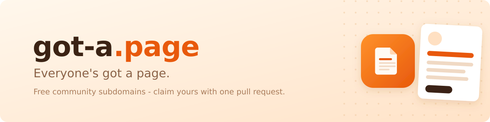

# Everyone's got a page.

**got-a.page** is a free, community-run subdomain service. Claim
`yourname.got-a.page` for your profile, product launch, project, portfolio,
community or event - with one small JSON file and one pull request.

- **No website?** Instant mode renders a beautiful, accessible page for you.
  Zero hosting, zero cost.
- **Already hosting?** Point mode maps your name to GitHub Pages, Vercel,
  Netlify, Cloudflare Pages - anywhere.

### Start here

| Repo | What's inside |
| --- | --- |
| [claim](https://github.com/got-a-page/claim) | Where pages are claimed - fork, add your file, PR |
| [website](https://github.com/got-a-page/website) | [got-a.page](https://got-a.page) - checker, claim form, docs, badges |
| [renderer](https://github.com/got-a-page/renderer) | The Cloudflare Worker that renders instant pages |

First pull request ever? You're in the right place - the
[guide](https://github.com/got-a-page/claim/blob/main/CONTRIBUTING.md) walks
you through every click, and the maintainers are kind.

Free forever. MIT licensed. No ads, no tracking, no star-begging - claim a
page because you want one.
